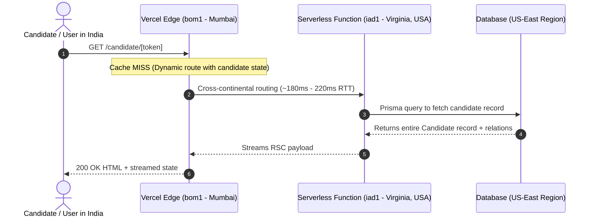

# Cynbit Technologies — Backend Technical Audit Report

**Author**: Kashish Rathore  
**Role Applied For**: Backend Developer Intern  
**Target Analyzed**: `https://www.cynbit.in`  
**Assessment Brief**: Analyze Cynbit From a Backend Perspective  
**Testing Approach**: 100% passive observation via public network traffic, HTTP response headers, browser devtools, client JS bundles, and React Server Component (RSC) wire responses. No active probing, penetration testing, or stress tests were conducted.

---

## 1. Introduction & Overview

When I set out to analyze Cynbit's platform from a backend perspective, my goal wasn't just to list random headers or buzzwords. I wanted to understand how the system actually works under the hood:
- How does the frontend communicate with backend services?
- How is candidate and platform state managed?
- What does the data flow look like across the network?
- Where are the architectural bottlenecks or security weak spots that an engineer on the team would want to address?

Cynbit has built a clean, modern web application using **Next.js (App Router with React Server Components)** deployed on **Vercel's Edge & Serverless network**, with **Prisma ORM** handling database interactions (evident from standard CUID identifier schemes) and **Cashfree** powering payment collection.

The site is snappy on static marketing routes, but once you dive into the dynamic flows — specifically the candidate assessment portal (`/candidate/[token]`) — you start spotting classic backend trade-offs and oversights. The most prominent ones are:
1. **Severe over-fetching on the candidate profile endpoint**, which sends internal recruitment notes, ratings, and even future onboarding credentials straight to the client browser.
2. **A geographical routing mismatch**: requests originating in India hit Vercel's Mumbai edge POP (`bom1`), but dynamic compute gets proxied all the way to Northern Virginia (`iad1`), introducing an avoidable ~200ms latency penalty.
3. **Missing baseline security headers** (CSP, X-Frame-Options, strict Referrer policies).
4. **Client-driven state polling** for payment verification using `localStorage` intervals rather than server-driven webhook notifications.

Below is my detailed breakdown of the system.

---

## 2. Infrastructure & Network Topology

### 2.1 The Observable Network Profile

To get a baseline, I inspected the HTTP response headers returned by the main website and the candidate portal route. Here is what came back:

```http
HTTP/1.1 200 OK
Server: Vercel
X-Powered-By: Next.js
Strict-Transport-Security: max-age=63072000
Access-Control-Allow-Origin: *
Cache-Control: private, no-cache, no-store, max-age=0, must-revalidate
Vary: rsc, next-router-state-tree, next-router-prefetch, next-router-segment-prefetch
X-Matched-Path: /candidate/[token]
X-Vercel-Cache: MISS
X-Vercel-Id: bom1::iad1::nj5vz-1793525027672-f57d939e1e8d
```

### 2.2 What This Tells Us About the Deployment Architecture

Look closely at `X-Vercel-Id: bom1::iad1::...` and `Vary: rsc...`:



1. **Edge Entry vs Origin Execution**:
   - `bom1` is Vercel's Point of Presence in Mumbai.
   - `iad1` is Dulles / Northern Virginia in the United States.
   - Even though the user is sitting in India browsing an Indian `.in` domain, every dynamic serverless function call travels halfway around the world to US-East before running. This adds roughly **180ms to 220ms of pure network transit time** to every dynamic request before any application logic or database queries even start.

2. **Framework Exposure**:
   - `X-Powered-By: Next.js` is sent in response headers. While common in development, leaving it in production gives automated crawlers and potential attackers free fingerprinting information.

3. **Wildcard Document CORS**:
   - `Access-Control-Allow-Origin: *` is present even on top-level pages and 404 responses. Cross-origin access should be restricted to trusted application origins rather than open to the entire web.

---

## 3. Dissecting the API & Server Actions

In Next.js App Router, instead of standard REST endpoints like `/api/v1/candidates`, backend mutations and data-fetching methods are commonly implemented as **Server Actions** or React Server Component queries.

By analyzing the client bundle loaded on the candidate page (`/_next/static/chunks/app/(marketing)/candidate/%5Btoken%5D/page-da5a6f561f8d3783.js`), I mapped out the 8 primary server action references registered by the backend:

| Action Name | Action Hash ID | What It Does |
| :--- | :--- | :--- |
| `fetchCandidateByCandidateToken` | `40d60747a860583aa4a36582415eacc44769f593ef` | Fetches the full candidate record, job info, and status |
| `submitCandidateAssessment` | `78de5071582a09a9b67d2d42a8aeda17e31bc0d611` | Saves the candidate's GitHub repo link and notes |
| `submitCandidateSupportTicket` | `4020656484ed7b6ad8533ce9666d27f62ab6c7eb9b` | Creates a support ticket linked to candidate ID |
| `createCashfreeOrder` | `40fadee9d56006937ac69b7d95ab6ec4d321bc7b85` | Initiates an order session with Cashfree payment gateway |
| `verifyCashfreePaymentStatus` | `60dc214a3925addf79cd89074e45a9389962aaddbd` | Polls Cashfree to check if an order succeeded |
| `verifyAndProcessEnrollment` | `60147a9e71f39aa4e4b107fbc6fda768cebaf5640b` | Finalizes candidate enrollment post-payment |
| `submitCandidateOnboarding` | `706b6de255fddb2160c9709c2ba463ea9ead136b3b` | Submits identity proof and digital signature |
| `subscribeToNewsletter` | `40cfc00a772b56a9f2cf23e0d2c13695fd6b5755e3` | Captures email addresses on marketing pages |

Having all these actions cleanly namespaced is a great foundation. However, how data flows through them needs tighter controls, as discussed below.

---

## 4. The Biggest Observation: Excessive Data Exposure (Over-Fetching)

### 4.1 What Actually Happened in the Network Tab

When the portal loads, it calls `fetchCandidateByCandidateToken` with the token from the URL (`cmv6c050r000d04l39fg2dix4`). 

Here is what the server sent back over the wire protocol:

```json
{
  "id": "cmv6c050r000c04l3crjsb348",
  "fullName": "Kashish Rathore",
  "email": "kashishrathoreo110@gmail.com",
  "jobId": "backend-developer-intern",
  "status": "ASSESSMENT",
  "rating": 0,
  "internalNotes": null,
  "assignedTo": null,
  "interviewDate": null,
  "offeredCtc": null,
  "joiningDate": null,
  "rejectionReason": null,
  "assessmentScore": null,
  "assessmentFeedback": null,
  "onboardingToken": "cmv6c050r000e04l3ocafykqn",
  "activationTokenHash": null,
  "trainingFeeOriginal": "3999",
  "trainingFeeScholarship": "1999",
  "scholarshipDiscountPct": 50,
  "paymentStatus": "UNPAID",
  "activityLogs": [
    {
      "id": "cmvw6naq8001608kzvhi5dtni",
      "actor": "Aria Automation Engine",
      "action": "AUTO_ASSESSMENT_ASSIGNED",
      "details": "Automated next-day morning technical assessment assigned for Backend Developer Intern: ...",
      "createdAt": "2026-10-31T09:12:24.848Z"
    }
  ],
  "allApplications": [ ... ]
}
```

### 4.2 Why This is a Big Deal

Notice what is inside this payload:
- **`internalNotes` & `rating`**: If an interviewer leaves internal evaluation notes or ratings, they will be sent directly to the candidate's browser.
- **`offeredCtc`**: Internal compensation details would be visible in client state before any formal offer is made.
- **`rejectionReason`**: Sensitive hiring remarks meant strictly for internal HR.
- **`onboardingToken`**: The candidate is only at the assessment stage, yet the token for the next stage (`cmv6c050r000e04l3ocafykqn`) is already exposed in client memory.
- **`activityLogs`**: Internal automation logs (such as automated rules run by "Aria Automation Engine") are fully serialized.

### 4.3 Why Did This Happen? (The Prisma Trap)

As backend developers working with Prisma ORM, it is very tempting to write:

```typescript
// Common mistake: fetching everything and returning it directly
export async function fetchCandidateByCandidateToken(token: string) {
  const candidate = await prisma.candidate.findUnique({
    where: { trainingToken: token },
    include: {
      job: true,
      activityLogs: true,
      allApplications: true,
    },
  });

  return candidate; // Leaks every column in the table!
}
```

Because Next.js Server Actions automatically serialize whatever you return, the entire database row travels over the internet into client-side React state.

### 4.4 How We Fix It: Explicit Data Transfer Objects (DTO)

The fix is straightforward and doesn't hurt productivity: use **explicit field selection** at the database layer, and return a clean **PublicCandidateDTO**:

```typescript
// The right way: Only select what the candidate portal UI actually needs
export const candidatePortalSelect = {
  id: true,
  fullName: true,
  email: true,
  jobId: true,
  assessmentTitle: true,
  assessmentPrompt: true,
  assessmentDeadline: true,
  assessmentSubmittedAt: true,
  assessmentSubmissionUrl: true,
  assessmentSubmissionLinks: true,
  paymentStatus: true,
  trainingFeeScholarship: true,
  status: true,
} as const;

export async function fetchCandidateByCandidateToken(token: string) {
  const candidate = await prisma.candidate.findUnique({
    where: { trainingToken: token },
    select: candidatePortalSelect, // Strict database projection
  });

  if (!candidate) return null;
  return toPublicCandidateDTO(candidate);
}
```

By doing this, internal notes, ratings, CTC offers, and downstream tokens never leave the database server in the first place.

---

## 5. Architectural Recommendations Summary

| Focus Area | Current State | Target Recommendation |
| :--- | :--- | :--- |
| **Data Projection** | Full ORM row serialization | Database-level `select` projection + `PublicCandidateDTO` |
| **Security Headers** | Basic headers only; no CSP/XFO | Full CSP, `X-Frame-Options: DENY`, `Referrer-Policy: strict-origin-when-cross-origin` |
| **Compute Location** | Edge in Mumbai (`bom1`) → Compute in Virginia (`iad1`) | Configure Serverless functions in `bom1` or Singapore (`sin1`) |
| **Payment Flow** | Client polls via 180s interval in `localStorage` | Webhook-driven status updates with HMAC signature checks |
| **Session Model** | Naked token in URL path | Signed session cookie exchanged on first load |

*For deep dive vulnerability categorization and reproducible tests, refer to [`SECURITY_AND_PERFORMANCE.md`](./SECURITY_AND_PERFORMANCE.md) and [`RECOMMENDATIONS.md`](./RECOMMENDATIONS.md).*
