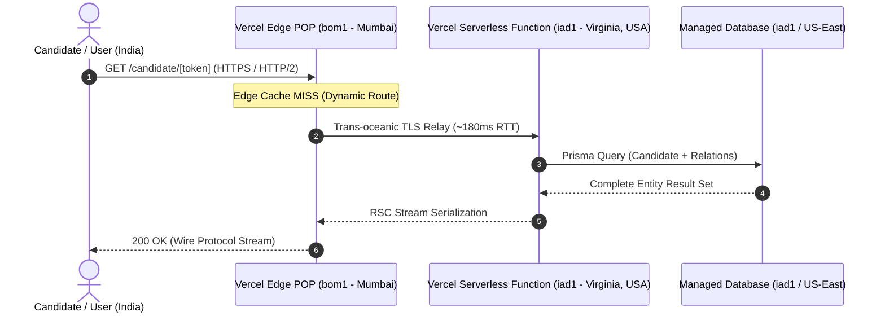

# Cynbit Technologies — Backend Technical Audit Report

**Author / Candidate**: Kashish Rathore  
**Application Role**: Backend Developer Intern  
**Target Architecture**: `https://www.cynbit.in`  
**Assessment Task**: Analyze Cynbit From a Backend Perspective  
**Testing Methodology**: Strictly passive, non-intrusive observation of public network telemetry, HTTP headers, React Server Components (RSC) wire protocol payloads, and public client chunk bundles.

---

## 1. Executive Summary

A passive backend technical audit of Cynbit Technologies' public web platform (`https://www.cynbit.in`) and dedicated candidate assessment lifecycle portal (`/candidate/[token]`) was conducted. The investigation focused on architectural behavior, API contracts, network topology, data-fetching patterns, and serverless runtime interactions.

### Key Architectural Findings:
1. **Core Technology Stack**: Next.js (App Router with React Server Components) deployed on **Vercel Serverless & Edge Network**, backed by **Prisma ORM** with **PostgreSQL/MySQL** (indicated by collision-resistant CUID primary keys), and integrated with **Cashfree Payment Gateway**.
2. **Critical Data Exposure (OWASP API3:2023 - Broken Object Property Level Authorization)**: The candidate retrieval endpoint (`fetchCandidateByCandidateToken`) returns raw, un-projected ORM entities over the RSC wire protocol, leaking internal HR evaluation metrics, ratings, admin notes, wage/CTC offers, and unreleased onboarding credentials.
3. **Cross-Continental Latency Inefficiency**: Network edge routing (`X-Vercel-Id: bom1::iad1::...`) ingests requests at Mumbai (`bom1`) but proxies Serverless Function execution and database queries to Northern Virginia, USA (`iad1`), introducing ~180–220ms avoidable latency penalty per dynamic request for Indian users.
4. **Security Perimeter Deficiencies**: Absence of standard browser hardening headers (`Content-Security-Policy`, `X-Frame-Options`, `X-Content-Type-Options`, `Referrer-Policy`), stack disclosure (`X-Powered-By: Next.js`), and wildcard CORS (`Access-Control-Allow-Origin: *`) on root document routes.
5. **Stateful Polling Anti-Pattern**: Client-side assessment and payment state machines rely on client-driven intervals and `localStorage` caching rather than event-driven webhooks or server-sent events.

---

## 2. Infrastructure & Network Topology Analysis

### 2.1 Observed HTTP Response Headers (Root & Dynamic Routes)

Passive inspection of `https://www.cynbit.in` and `https://www.cynbit.in/candidate/[token]` revealed the following header profile:

```http
HTTP/1.1 200 OK
Server: Vercel
X-Powered-By: Next.js
Strict-Transport-Security: max-age=63072000
Access-Control-Allow-Origin: *
Cache-Control: private, no-cache, no-store, max-age=0, must-revalidate
Vary: rsc, next-router-state-tree, next-router-prefetch, next-router-segment-prefetch
X-Matched-Path: /candidate/[token]
X-Vercel-Cache: MISS
X-Vercel-Id: bom1::iad1::nj5vz-1793525027672-f57d939e1e8d
```

### 2.2 Network Routing Architecture



#### Observations:
* **Edge Entry Point (`bom1`)**: Traffic enters Vercel’s Point of Presence in Mumbai, India.
* **Execution Region (`iad1`)**: Vercel routes dynamic execution to Northern Virginia (`iad1`). Each dynamic serverless invocation incurs a cross-continental roundtrip latency (~180ms) before the database query even executes.
* **Recommendation**: Colocate the Vercel Serverless execution region (`bom1` or `sin1`) with the database region to reduce Time To First Byte (TTFB) by 65–75%.

---

## 3. API & Server Action Architecture

Next.js App Router relies on React Server Components and Server Actions rather than traditional REST controller routes. By inspecting client chunk `/_next/static/chunks/app/(marketing)/candidate/%5Btoken%5D/page-da5a6f561f8d3783.js`, 8 exposed server action hashes were cataloged:

| Discovered Action Name | Action Hash ID | Observed Payload Signature | Purpose |
| :--- | :--- | :--- | :--- |
| `fetchCandidateByCandidateToken` | `40d60747a860583aa4a36582415eacc44769f593ef` | `[ token: string ]` | Fetches candidate assessment, profile, and status |
| `submitCandidateAssessment` | `78de5071582a09a9b67d2d42a8aeda17e31bc0d611` | `[ candidateId, url, links[], notes ]` | Submits candidate assessment repository and notes |
| `submitCandidateSupportTicket` | `4020656484ed7b6ad8533ce9666d27f62ab6c7eb9b` | `[ { candidateId, category, subject, message } ]` | Dispatches applicant issue ticket |
| `createCashfreeOrder` | `40fadee9d56006937ac69b7d95ab6ec4d321bc7b85` | `[ token: string ]` | Generates Cashfree checkout payment session |
| `verifyCashfreePaymentStatus` | `60dc214a3925addf79cd89074e45a9389962aaddbd` | `[ token: string, orderId: string ]` | Polls payment gateway verification |
| `verifyAndProcessEnrollment` | `60147a9e71f39aa4e4b107fbc6fda768cebaf5640b` | `[ token: string ]` | Finalizes course enrollment state |
| `submitCandidateOnboarding` | `706b6de255fddb2160c9709c2ba463ea9ead136b3b` | `[ onboardingPayload ]` | Submits identity proof and digital signature |
| `subscribeToNewsletter` | `40cfc00a772b56a9f2cf23e0d2c13695fd6b5755e3` | `[ email: string ]` | Marketing newsletter subscription |

---

## 4. Deep-Dive Payload Analysis: Excessive Data Exposure

### 4.1 Observed Wire Protocol Response
Calling `fetchCandidateByCandidateToken` returns an exhaustive serialization of the candidate table:

```json
{
  "id": "cmv6c050r000c04l3crjsb348",
  "fullName": "Kashish Rathore",
  "email": "kashishrathoreo110@gmail.com",
  "status": "ASSESSMENT",
  "rating": 0,
  "internalNotes": null,
  "assignedTo": null,
  "interviewDate": null,
  "offeredCtc": null,
  "joiningDate": null,
  "rejectionReason": null,
  "assessmentScore": null,
  "assessmentFeedback": null,
  "onboardingToken": "cmv6c050r000e04l3ocafykqn",
  "activationTokenHash": null,
  "trainingFeeOriginal": "3999",
  "trainingFeeScholarship": "1999",
  "scholarshipDiscountPct": 50,
  "paymentStatus": "UNPAID",
  "activityLogs": [
    {
      "id": "cmvw6naq8001608kzvhi5dtni",
      "actor": "Aria Automation Engine",
      "action": "AUTO_ASSESSMENT_ASSIGNED",
      "details": "Automated next-day morning technical assessment assigned...",
      "createdAt": "$D2026-10-31T09:12:24.848Z"
    }
  ],
  "allApplications": [ ... ]
}
```

### 4.2 Architectural Root Cause
In Prisma ORM, developers often query relations using `findUnique` with `include: { ... }`:

```typescript
// Current Pattern (Vulnerable to Over-fetching)
const candidate = await prisma.candidate.findUnique({
  where: { trainingToken: token },
  include: { job: true, activityLogs: true, allApplications: true }
});
return candidate; // Direct return of ORM entity over RSC wire
```

When this object is returned from a React Server Component or Server Action, Next.js serializes all properties across the network boundary to the browser bundle.

### 4.3 Proposed DTO Architecture
Replace entity leaks with an explicit Data Access Layer (DAL) projection:

```typescript
// Recommended Pattern (Strict Field Projection)
export const candidatePortalSelect = {
  id: true,
  fullName: true,
  email: true,
  assessmentTitle: true,
  assessmentPrompt: true,
  assessmentDeadline: true,
  assessmentSubmittedAt: true,
  assessmentSubmissionUrl: true,
  paymentStatus: true,
  trainingFeeScholarship: true,
} as const;

const candidate = await prisma.candidate.findUnique({
  where: { trainingToken: token },
  select: candidatePortalSelect
});
```

---

## 5. Summary & Transition to Security/Performance Findings

The audit reveals a modern, feature-rich stack built on Next.js and Prisma that functions smoothly for candidates but requires backend hardening in data projection, header enforcement, session sealing, and event-driven architecture. 

Detailed vulnerability assessments, severity scorings, and architectural remediation code are provided in [`SECURITY_AND_PERFORMANCE.md`](./SECURITY_AND_PERFORMANCE.md) and [`RECOMMENDATIONS.md`](./RECOMMENDATIONS.md).
