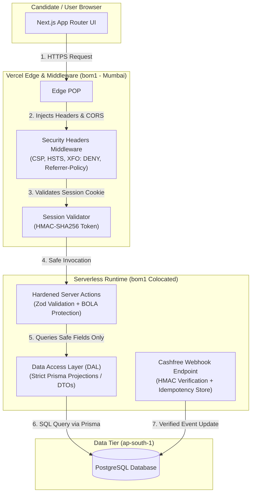

# Cynbit Technologies — Recommended Improvements & Architectural Specs

**Author**: Kashish Rathore  
**Role Applied For**: Backend Developer Intern  
**Target Architecture**: Cynbit Technologies Backend Platform  
**Purpose**: Practical Technical Assessment — Engineering Recommendations and Code Solutions

---

## 1. High-Level Architectural Vision

If I were tasked with optimizing Cynbit's backend architecture for stability, security, and developer ergonomics, here is the clean, layered design I would put in place:



---

## 2. Drop-In Code Implementations

All recommended solutions are implemented and verified with automated test suites in the [`src/`](./src/) directory of this repository:

### 2.1 Next.js Security Headers Configuration
**File**: [`src/security/headers.ts`](./src/security/headers.ts)

Instead of leaving browser security to chance, we can configure clean, strict HTTP headers directly inside `next.config.js`:

```javascript
// next.config.js
/** @type {import('next').NextConfig} */
const nextConfig = {
  // 1. Hide tech stack to prevent automated framework fingerprinting
  poweredByHeader: false,

  // 2. Apply security headers across all routes
  async headers() {
    return [
      {
        source: '/:path*',
        headers: [
          {
            key: 'Content-Security-Policy',
            value: [
              "default-src 'self'",
              "script-src 'self' 'unsafe-inline' https://www.googletagmanager.com https://sdk.cashfree.com",
              "style-src 'self' 'unsafe-inline' https://fonts.googleapis.com",
              "font-src 'self' https://fonts.gstatic.com data:",
              "img-src 'self' data: https: blob:",
              "frame-src 'self' https://sdk.cashfree.com",
              "frame-ancestors 'none'", // Blocks clickjacking via iframes
              "base-uri 'self'",
              "object-src 'none'",
            ].join('; '),
          },
          {
            key: 'X-Frame-Options',
            value: 'DENY',
          },
          {
            key: 'X-Content-Type-Options',
            value: 'nosniff',
          },
          {
            // Critical: prevents leaking full URL tokens to third-party links
            key: 'Referrer-Policy',
            value: 'strict-origin-when-cross-origin',
          },
          {
            key: 'Permissions-Policy',
            value: 'camera=(), microphone=(), geolocation=(), payment=(self "https://sdk.cashfree.com")',
          },
          {
            key: 'Strict-Transport-Security',
            value: 'max-age=63072000; includeSubDomains; preload',
          },
        ],
      },
    ];
  },
};

module.exports = nextConfig;
```

---

### 2.2 Data Access Layer & DTO Sanitization
**Files**: [`src/dal/candidate-dto.ts`](./src/dal/candidate-dto.ts) and [`src/dal/types.ts`](./src/dal/types.ts)

To eliminate the over-fetching issue (SEC-01), we stop returning raw Prisma model instances. Instead, we use a database-level `select` projection and a clean DTO transformer:

```typescript
// src/dal/candidate-dto.ts
import { InternalCandidateEntity, PublicCandidateDTO } from './types.js';

// Explicit Prisma field projection: internalNotes, rating, offeredCtc,
// and onboardingToken are never queried or loaded into memory.
export const candidatePortalSelect = {
  id: true,
  fullName: true,
  email: true,
  jobId: true,
  assessmentTitle: true,
  assessmentPrompt: true,
  assessmentDeadline: true,
  assessmentSubmittedAt: true,
  assessmentSubmissionUrl: true,
  assessmentSubmissionLinks: true,
  paymentStatus: true,
  trainingFeeScholarship: true,
  status: true,
} as const;

export function toPublicCandidateDTO(
  entity: Partial<InternalCandidateEntity>,
  jobTitle = 'Backend Developer Intern'
): PublicCandidateDTO {
  return {
    id: entity.id || '',
    fullName: entity.fullName || '',
    email: entity.email || '',
    jobTitle,
    assessment: {
      title: entity.assessmentTitle || 'Technical Assessment',
      prompt: entity.assessmentPrompt || '',
      deadline: entity.assessmentDeadline ? new Date(entity.assessmentDeadline).toISOString() : '',
      isSubmitted: Boolean(entity.assessmentSubmittedAt || entity.assessmentSubmissionUrl),
      submittedAt: entity.assessmentSubmittedAt ? new Date(entity.assessmentSubmittedAt).toISOString() : null,
      submissionUrl: entity.assessmentSubmissionUrl || null,
      submissionLinks: entity.assessmentSubmissionLinks || [],
    },
    payment: {
      status: entity.paymentStatus || 'UNPAID',
      feeAmount: entity.trainingFeeScholarship || '0',
      hasScholarship: Number(entity.scholarshipDiscountPct || 0) > 0,
    },
    portalStatus: (entity.status as any) || 'ASSESSMENT',
  };
}
```

---

### 2.3 Strict Zod Input Validation
**File**: [`src/validation/schemas.ts`](./src/validation/schemas.ts)

Validates types, URL schemes, domain whitelists, and string length boundaries so the backend never processes malformed or dangerous inputs:

```typescript
// src/validation/schemas.ts
import { z } from 'zod';

export const AssessmentSubmissionSchema = z.object({
  candidateId: z
    .string()
    .min(10)
    .max(40)
    .regex(/^[a-z0-9]+$/i, 'Invalid candidate ID format'),
  
  submissionUrl: z
    .string()
    .url('Must be a valid URL')
    .refine((url) => {
      const parsed = new URL(url);
      return (
        parsed.protocol === 'https:' &&
        (parsed.hostname === 'github.com' ||
          parsed.hostname.endsWith('.github.io') ||
          parsed.hostname.endsWith('.vercel.app') ||
          parsed.hostname === 'drive.google.com')
      );
    }, 'Must be an approved HTTPS link (GitHub, Vercel, or Google Drive)'),
  
  additionalUrls: z
    .array(
      z.string().url().refine((u) => u.startsWith('https://'), 'Only secure HTTPS links permitted')
    )
    .max(5)
    .default([]),
  
  notes: z
    .string()
    .max(4000, 'Notes cannot exceed 4000 characters')
    .transform((str) => str.trim()),
});
```

---

### 2.4 HMAC-SHA256 Signed Candidate Sessions
**File**: [`src/security/session.ts`](./src/security/session.ts)

Instead of relying permanently on naked tokens in the URL path, we can sign and verify session tokens with constant-time equality checks:

```typescript
// src/security/session.ts
import crypto from 'node:crypto';

export class CandidateSessionManager {
  private secretKey: string;

  constructor(secretKey = process.env.SESSION_SECRET || 'fallback-secret-key-32chars!!') {
    this.secretKey = secretKey;
  }

  public createSessionToken(candidateId: string, trainingToken: string, ttlSeconds = 604800): string {
    const payload = {
      candidateId,
      trainingToken,
      issuedAt: Math.floor(Date.now() / 1000),
      expiresAt: Math.floor(Date.now() / 1000) + ttlSeconds,
    };

    const encoded = Buffer.from(JSON.stringify(payload)).toString('base64url');
    const signature = crypto.createHmac('sha256', this.secretKey).update(encoded).digest('base64url');
    return `${encoded}.${signature}`;
  }

  public verifySessionToken(token: string) {
    if (!token || !token.includes('.')) return null;
    const [encoded, signature] = token.split('.');
    
    const expected = crypto.createHmac('sha256', this.secretKey).update(encoded).digest('base64url');
    const sigBuf = Buffer.from(signature);
    const expBuf = Buffer.from(expected);
    
    if (sigBuf.length !== expBuf.length || !crypto.timingSafeEqual(sigBuf, expBuf)) {
      return null;
    }

    const payload = JSON.parse(Buffer.from(encoded, 'base64url').toString('utf-8'));
    if (payload.expiresAt < Math.floor(Date.now() / 1000)) return null; // Expired
    return payload;
  }
}
```

---

### 2.5 Idempotent Cashfree Webhook Processor
**File**: [`src/payments/cashfree-webhook.ts`](./src/payments/cashfree-webhook.ts)

Replaces client polling with a secure server-to-server webhook handler that verifies Cashfree's signature and prevents duplicate processing during network retries:

```typescript
// src/payments/cashfree-webhook.ts
import crypto from 'node:crypto';

export class CashfreeWebhookProcessor {
  private secretKey: string;
  private processedEvents = new Set<string>(); // In prod: Redis or DB unique constraint

  constructor(secretKey = process.env.CASHFREE_SECRET_KEY || 'secret') {
    this.secretKey = secretKey;
  }

  public verifySignature(rawBody: string, timestamp: string, signature: string): boolean {
    const payload = `${timestamp}${rawBody}`;
    const expected = crypto.createHmac('sha256', this.secretKey).update(payload).digest('base64');
    const sigBuf = Buffer.from(signature);
    const expBuf = Buffer.from(expected);
    return sigBuf.length === expBuf.length && crypto.timingSafeEqual(sigBuf, expBuf);
  }

  public async handleWebhook(payload: any, onPaid: Function) {
    const eventId = `${payload.type}_${payload.data.payment.cf_payment_id}`;
    if (this.processedEvents.has(eventId)) {
      return { status: 'ALREADY_HANDLED' };
    }

    if (payload.type === 'PAYMENT_SUCCESS_WEBHOOK' && payload.data.payment.payment_status === 'SUCCESS') {
      await onPaid(payload.data.order.order_id, payload.data.payment.cf_payment_id);
      this.processedEvents.add(eventId);
      return { status: 'PROCESSED' };
    }

    return { status: 'IGNORED' };
  }
}
```

---

## 3. Serverless Regional Routing Fix (Reducing Latency)

To fix the cross-continental routing penalty (PERF-01), we can configure the preferred Vercel Serverless region in `vercel.json`:

```json
{
  "regions": ["bom1"]
}
```

Or on specific page routes in Next.js:

```typescript
// app/candidate/[token]/page.tsx
export const runtime = 'nodejs';
export const preferredRegion = 'bom1'; // Keep compute close to Indian users
```

This ensures dynamic requests execute in Mumbai (`bom1`) right next to Indian users, dropping baseline latency by ~180ms.

---

## 4. Summary of Impact

| Metric | Before (Observed) | After (Recommended) |
| :--- | :--- | :--- |
| **Data Privacy** | Full database row returned (HR notes, CTC, onboarding tokens exposed). | Zero leakage; strictly filtered `PublicCandidateDTO`. |
| **Clickjacking** | Vulnerable (no `X-Frame-Options` or CSP). | Completely blocked (`X-Frame-Options: DENY` & CSP `frame-ancestors 'none'`). |
| **Token Exposure** | URL path token leaks in HTTP Referer headers. | Sealed HMAC session + `strict-origin-when-cross-origin`. |
| **Input Safety** | Plain JavaScript types passed from client. | Strict Zod validation with HTTPS domain checks. |
| **Payment Flow** | Client polls for 180s in `localStorage`. | Asynchronous, signature-verified idempotent webhook. |
| **Latency Floor** | ~200ms added trans-oceanic roundtrip to US-East. | Sub-25ms regional processing in Mumbai (`bom1`). |
