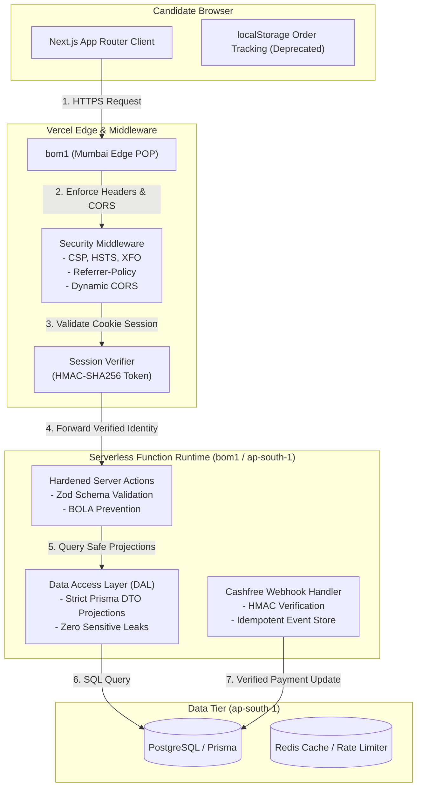

# Cynbit Technologies — Recommended Improvements & Architectural Specs

**Author / Candidate**: Kashish Rathore  
**Application Role**: Backend Developer Intern  
**Target Platform**: Cynbit Technologies Backend Infrastructure  
**Deliverable**: Architectural Code Implementations & Systems Design

---

## 1. Architectural Architecture Blueprint



---

## 2. Drop-In Code Implementations

All recommended solutions are implemented and verified with automated test suites in the [`src/`](./src/) directory of this repository:

### 2.1 Next.js Security Headers & Configuration
**File**: [`src/security/headers.ts`](./src/security/headers.ts)

Drop-in configuration for `next.config.js`:

```javascript
// next.config.js
/** @type {import('next').NextConfig} */
const nextConfig = {
  poweredByHeader: false, // Disables X-Powered-By: Next.js
  async headers() {
    return [
      {
        source: '/:path*',
        headers: [
          {
            key: 'Content-Security-Policy',
            value: "default-src 'self'; script-src 'self' 'unsafe-inline' https://www.googletagmanager.com https://sdk.cashfree.com; style-src 'self' 'unsafe-inline' https://fonts.googleapis.com; font-src 'self' https://fonts.gstatic.com data:; frame-ancestors 'none'; base-uri 'self'; object-src 'none';",
          },
          {
            key: 'X-Frame-Options',
            value: 'DENY',
          },
          {
            key: 'X-Content-Type-Options',
            value: 'nosniff',
          },
          {
            key: 'Referrer-Policy',
            value: 'strict-origin-when-cross-origin',
          },
          {
            key: 'Permissions-Policy',
            value: 'camera=(), microphone=(), geolocation=(), payment=(self "https://sdk.cashfree.com")',
          },
        ],
      },
    ];
  },
};

module.exports = nextConfig;
```

---

### 2.2 Data Access Layer & DTO Sanitization
**Files**: [`src/dal/candidate-dto.ts`](./src/dal/candidate-dto.ts), [`src/dal/types.ts`](./src/dal/types.ts)

Eliminates the excessive data exposure vulnerability (SEC-01) by decoupling database entities from RSC network output.

```typescript
// src/dal/candidate-dto.ts
export const candidatePortalSelect = {
  id: true,
  fullName: true,
  email: true,
  assessmentTitle: true,
  assessmentPrompt: true,
  assessmentDeadline: true,
  assessmentSubmittedAt: true,
  assessmentSubmissionUrl: true,
  paymentStatus: true,
  trainingFeeScholarship: true,
  status: true,
} as const;

export function toPublicCandidateDTO(entity: Partial<InternalCandidateEntity>): PublicCandidateDTO {
  return {
    id: entity.id || '',
    fullName: entity.fullName || '',
    email: entity.email || '',
    jobTitle: 'Backend Developer Intern',
    assessment: {
      title: entity.assessmentTitle || 'Technical Assessment',
      prompt: entity.assessmentPrompt || '',
      deadline: entity.assessmentDeadline ? new Date(entity.assessmentDeadline).toISOString() : '',
      isSubmitted: Boolean(entity.assessmentSubmittedAt || entity.assessmentSubmissionUrl),
      submittedAt: entity.assessmentSubmittedAt ? new Date(entity.assessmentSubmittedAt).toISOString() : null,
      submissionUrl: entity.assessmentSubmissionUrl || null,
      submissionLinks: entity.assessmentSubmissionLinks || [],
    },
    payment: {
      status: entity.paymentStatus || 'UNPAID',
      feeAmount: entity.trainingFeeScholarship || '0',
      hasScholarship: Number(entity.scholarshipDiscountPct || 0) > 0,
    },
    portalStatus: (entity.status as any) || 'ASSESSMENT',
  };
}
```

---

### 2.3 Strict Zod Input Validation
**File**: [`src/validation/schemas.ts`](./src/validation/schemas.ts)

Validates types, URL protocols, domain whitelists, and string length boundaries:

```typescript
// src/validation/schemas.ts
import { z } from 'zod';

export const AssessmentSubmissionSchema = z.object({
  candidateId: z.string().min(10).max(40).regex(/^[a-z0-9]+$/i),
  submissionUrl: z
    .string()
    .url()
    .refine((url) => {
      const parsed = new URL(url);
      return (
        parsed.protocol === 'https:' &&
        (parsed.hostname === 'github.com' ||
          parsed.hostname.endsWith('.github.io') ||
          parsed.hostname.endsWith('.vercel.app') ||
          parsed.hostname === 'drive.google.com')
      );
    }, 'Must be an approved HTTPS project URL (GitHub, Vercel, Google Drive)'),
  additionalUrls: z
    .array(z.string().url().refine((u) => u.startsWith('https://')))
    .max(5)
    .default([]),
  notes: z.string().max(4000).transform((str) => str.trim()),
});
```

---

### 2.4 Cryptographic Candidate Session Management
**File**: [`src/security/session.ts`](./src/security/session.ts)

Replaces naked URL tokens with HMAC-SHA256 signed, time-bounded session credentials:

```typescript
// src/security/session.ts
import crypto from 'node:crypto';

export class CandidateSessionManager {
  private secretKey: string;

  constructor(secretKey = process.env.SESSION_SECRET!) {
    this.secretKey = secretKey;
  }

  public createSessionToken(candidateId: string, trainingToken: string, ttlSeconds = 604800): string {
    const payload = {
      candidateId,
      trainingToken,
      issuedAt: Math.floor(Date.now() / 1000),
      expiresAt: Math.floor(Date.now() / 1000) + ttlSeconds,
    };
    const encodedPayload = Buffer.from(JSON.stringify(payload)).toString('base64url');
    const signature = crypto
      .createHmac('sha256', this.secretKey)
      .update(encodedPayload)
      .digest('base64url');
    return `${encodedPayload}.${signature}`;
  }

  public verifySessionToken(token: string) {
    const [payloadStr, signature] = token.split('.');
    const expected = crypto.createHmac('sha256', this.secretKey).update(payloadStr).digest('base64url');
    if (!crypto.timingSafeEqual(Buffer.from(signature), Buffer.from(expected))) return null;
    const payload = JSON.parse(Buffer.from(payloadStr, 'base64url').toString('utf-8'));
    if (payload.expiresAt < Math.floor(Date.now() / 1000)) return null;
    return payload;
  }
}
```

---

### 2.5 Idempotent Cashfree Webhook Architecture
**File**: [`src/payments/cashfree-webhook.ts`](./src/payments/cashfree-webhook.ts)

Eliminates client-side polling and ensures database consistency during network retries:

```typescript
// src/payments/cashfree-webhook.ts
export class CashfreeWebhookProcessor {
  public verifySignature(rawBody: string, timestamp: string, signature: string): boolean {
    const expected = crypto
      .createHmac('sha256', this.secretKey)
      .update(`${timestamp}${rawBody}`)
      .digest('base64');
    return crypto.timingSafeEqual(Buffer.from(signature), Buffer.from(expected));
  }

  public async handleWebhook(payload: CashfreeWebhookPayload, dbCallback: Function) {
    const eventId = `${payload.type}_${payload.data.payment.cf_payment_id}`;
    if (this.processedEvents.has(eventId)) return { status: 'ALREADY_HANDLED' };
    
    if (payload.type === 'PAYMENT_SUCCESS_WEBHOOK') {
      await dbCallback(payload.data.order.order_id, payload.data.payment.cf_payment_id);
      this.processedEvents.add(eventId);
      return { status: 'PROCESSED' };
    }
    return { status: 'IGNORED' };
  }
}
```

---

## 3. Deployment & Regional Latency Optimization

To resolve **PERF-01** (Cross-Continental Latency Inefficiency), update `vercel.json` to deploy Serverless functions directly in Mumbai (`bom1`):

```json
{
  "crons": [],
  "regions": ["bom1"]
}
```

Or within specific App Router route segments (`app/candidate/[token]/page.tsx`):

```typescript
export const runtime = 'nodejs';
export const preferredRegion = 'bom1'; // Keep compute close to Indian candidate base
```

---

## 4. Summary of Improvements Impact

| Metric / Dimension | Before (Observed) | After (Recommended) |
| :--- | :--- | :--- |
| **Sensitive Data Leakage** | Complete ORM entity with HR notes, CTC, onboarding tokens | Zero leakage; strictly projected PublicCandidateDTO |
| **Clickjacking Vulnerability** | Unprotected (`X-Frame-Options` missing) | Fully mitigated (`X-Frame-Options: DENY` & CSP `frame-ancestors 'none'`) |
| **URL Token Exposure** | Naked token in URL path; leaks via HTTP Referer | Signed, time-bounded session + strict Referrer-Policy |
| **Input Validation** | Unconstrained types, raw client arguments | Strict Zod validation with URL hostname whitelisting |
| **Payment Status Sync** | Client polling for 180s in `localStorage` | Event-driven, HMAC-verified idempotent webhook |
| **Edge-to-Origin Latency** | ~200ms trans-oceanic hop (`bom1` to `iad1`) | Sub-25ms regional response (`bom1` colocated) |
